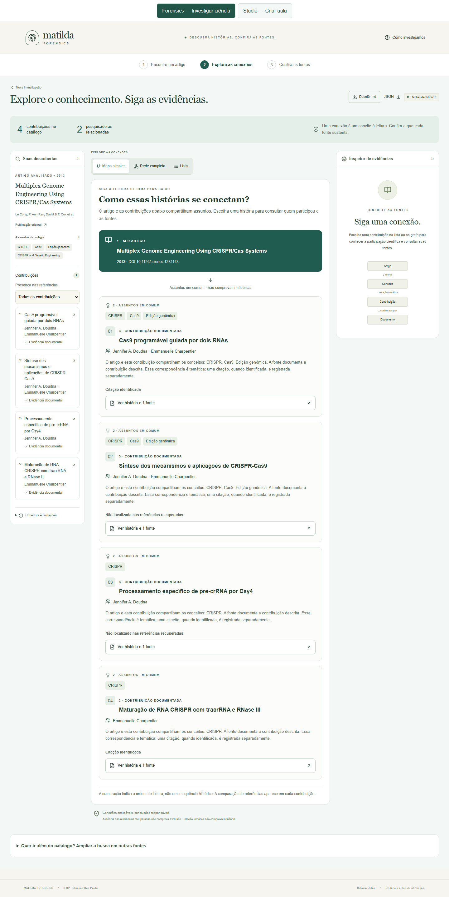
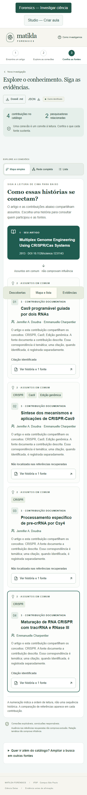

# Forensics: navegação e mapa guiado

Tarefa: [#33](https://github.com/zazacknazzo/Matilda-mvp/issues/33).

## Problema
O Forensics expõe muitos nós, relações e controles ao mesmo tempo. Pessoas sem familiaridade com grafos precisam de uma leitura simples e de navegação confortável no celular.

## Responsável e escopo
Implementação: Codex, branch `feat/forensics-accessible-redesign`. Arquivos: App, apresentação do Forensics, novo mapa guiado, linguagem do inspetor e testes de navegador. Contratos da API e Studio preservados.

## Critérios de aceite
- Entrada por DOI e exemplos com orientação em português e etapas visíveis.
- Mapa simples por padrão, com artigo, assuntos, contribuição, participantes, classificação bibliográfica e acesso ao dossiê.
- Rede completa e lista de todas as relações continuam disponíveis.
- Filtro aplicado aos cartões do mapa, estados vazios explícitos e seleção acessível por teclado.
- Navegação entre descobertas, mapa e evidências no celular sem rolagem horizontal.
- Fontes, exportações e limitações científicas preservadas; busca ampliada disponível por divulgação progressiva.
- Build e testes pertinentes executados; revisão independente antes da integração.

## Validação em 22/10/2026

- `npm.cmd run build`: compilação TypeScript e produção concluídas. Vite mantém
  aviso de bundle acima de 500 kB; divisão de código não integra esta mudança.
- `node node_modules/@playwright/test/cli.js test --config playwright.studio.config.ts`:
  12 testes aprovados, incluindo regressão Studio com API/SQLite e provedor
  controlado de testes. O teste do mapa verifica filtros, ausência de rolagem
  horizontal e foco nas fontes em 320, 390, 768, 1024 e 1440 px.
- `.venv/Scripts/python.exe -X utf8 -m pytest backend/tests -q`:
  554 testes aprovados. No Windows, UTF-8 é necessário para os JSONs existentes;
  sem a flag, a leitura pelo padrão cp1252 falha. Não houve mudança backend.
- Revisão estática independente concluída; o problema de fontes fora da viewport
  em tablet/desktop foi corrigido e coberto no teste de navegação.
- Capturas de início, mapa desktop, mapa celular, rede e evidências revisadas.

Validação automatizada não substitui teste de usabilidade com pessoas leigas.
O catálogo, seus limites de cobertura e a metodologia permanecem os existentes.
